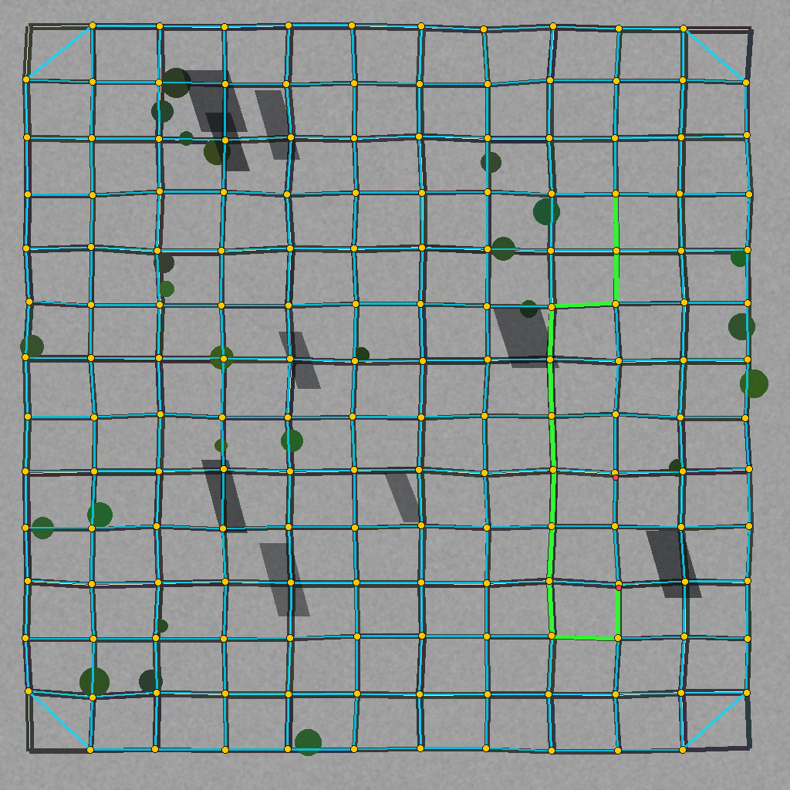
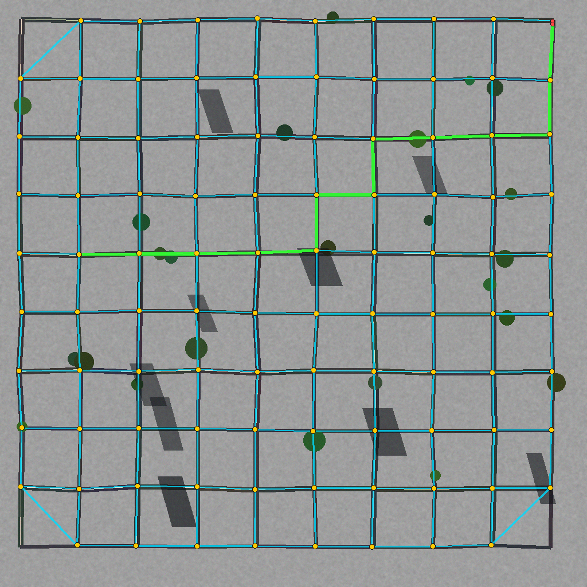
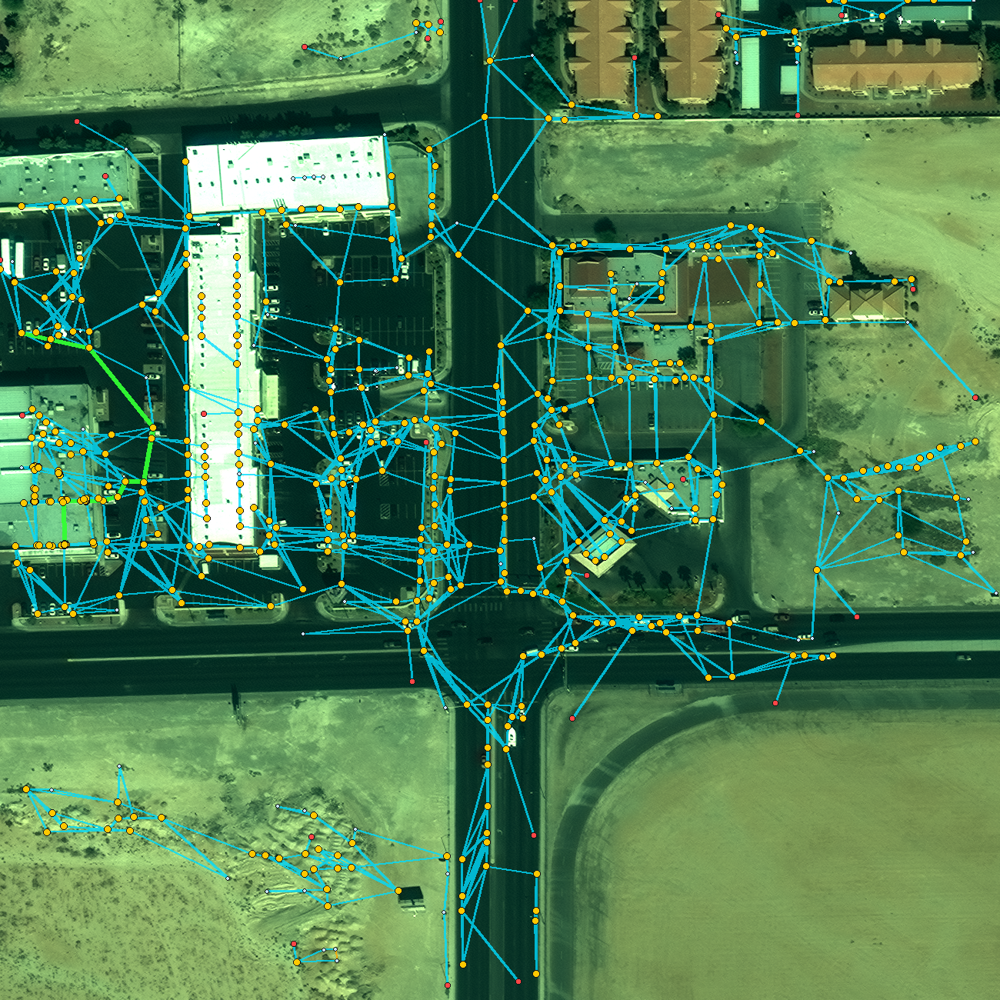
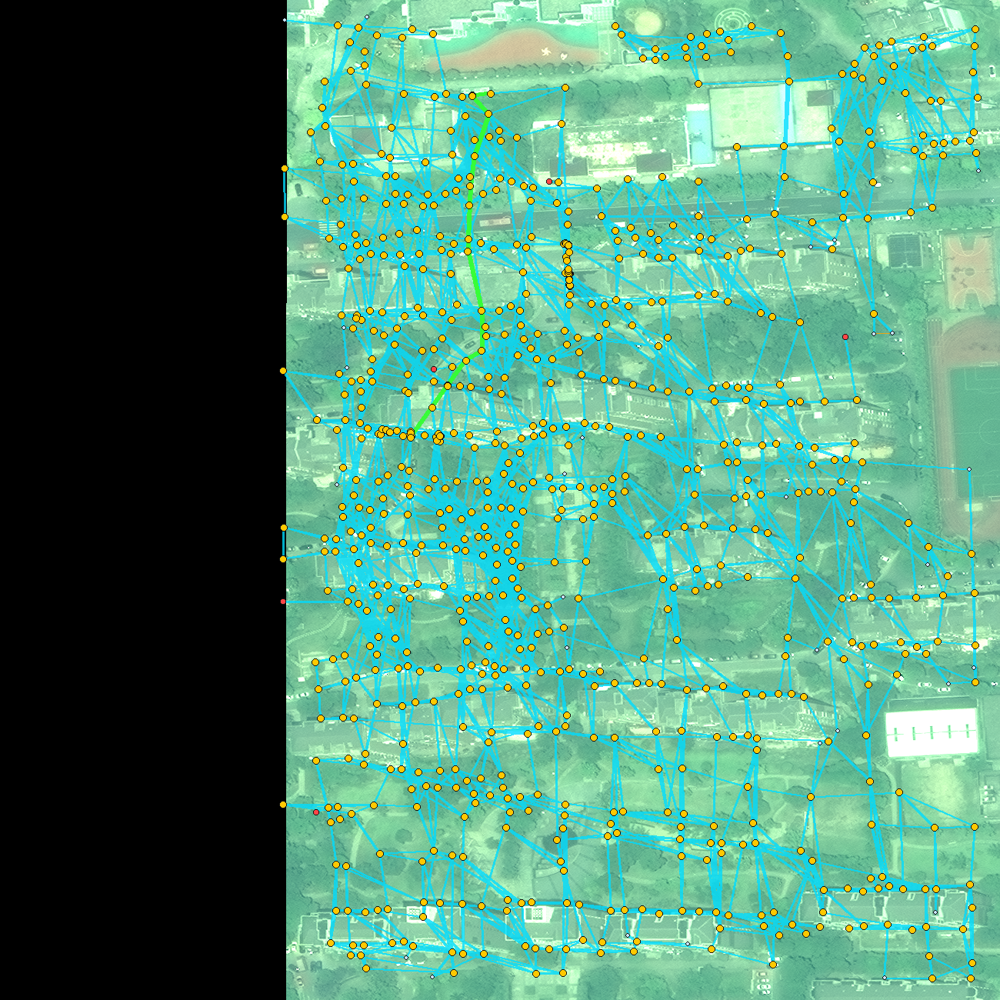

<div align="center">

# 🛰️ TopoGrapher
### Autonomous Neural Road Network & Topology Graph Extraction Engine
**Transform raw satellite, aerial, and drone imagery into topologically closed, routable vector road networks.**

[](https://www.python.org/downloads/)
[](https://pytorch.org/)
[](LICENSE)
[](tests/)
[](docs/BENCHMARKS.md)
[](https://developer.nvidia.com/cuda-zone)

[Key Features](#-key-features) •
[Quickstart](#-quickstart) •
[CLI Usage](#-cli-usage) •
[Benchmarks](#-benchmarks--telemetry) •
[Architecture](#-architecture) •
[GIS Formats](#-gis-interoperability)

</div>

---

## 🌟 Visual Results

<table>
  <tr>
    <td width="50%">
      
      <p align="center"><b>Barcelona (Eixample Octagonal Grid)</b><br><i>APLS: 0.9669 | Precision: 99.2% | Recall: 94.2%</i></p>
    </td>
    <td width="50%">
      
      <p align="center"><b>Manhattan (High-Density Urban Canyon)</b><br><i>APLS: 0.8731 | Precision: 96.1% | Recall: 78.6%</i></p>
    </td>
  </tr>
  <tr>
    <td width="50%">
      
      <p align="center"><b>Las Vegas (DigitalGlobe WorldView-3 Satellite)</b><br><i>Commercial Satellite 0.3m GSD | Reachability: 88.0% | A* OK</i></p>
    </td>
    <td width="50%">
      
      <p align="center"><b>Shanghai (WorldView-3 Commercial Megacity)</b><br><i>Dense Megacity Orthophoto | Reachability: 100.0% | A* OK</i></p>
    </td>
  </tr>
</table>

---

## 🚀 Key Features

- **Beyond Segmentation**: Unlike standard U-Net/Mask-RCNN models that output pixel rasters with disconnected gaps, TopoGrapher directly emits **topologically verified vector graphs** ($\mathcal{G} = \{\mathcal{V}, \mathcal{E}\}$).
- **ConvNeXt-FPN Visual Encoder**: 4-stage multiscale pyramid features capturing both microscopic lane details and macroscopic neighborhood connectivity.
- **Cognitive Edge Transformer**: Multi-head self-attention evaluating candidate road connections via continuous directional tangents and corridor profile line-sampling.
- **Relational GNN Refiner**: Line-Graph message passing enforcing topological flow conservation (intersections must continue, preventing phantom dead-ends).
- **Automated Mathematical Simplifier**:
  - **Gabriel Corridor Filter**: Eliminates redundant multi-hop chords skipping intermediate road nodes.
  - **Proximity Angular Sector NMS**: Suppresses multi-degree spiderwebs (degrees 8–23) and prioritizes immediate adjacent nodes.
  - **Parallel-Road Disambiguation**: Detects and prunes perpendicular ladder rungs between parallel lanes.
  - **Overpass Grade-Separation Resolver**: Preserves high-speed bridges (`layer=1`, `bridge=yes`) without false 4-way planar cuts.
  - **Degree-2 Polyline Collapsing**: Simplifies graph nodes into single edges with embedded sub-pixel polylines for GIS.
- **Production GIS Exporters**: Directly exports to **GeoJSON FeatureCollections** and **OpenStreetMap XML (`.osm`)** for instant loading in QGIS, JOSM, or ArcGIS.
- **Turn-by-Turn Routing Engine**: Built-in Dijkstra and A* pathfinding calculating travel distances and navigation routes directly on extracted vectors.

---

## 📦 Installation

```bash
# Clone repository
git clone https://github.com/your-username/topographer.git
cd topographer

# Install in editable mode
pip install -e .
```

### Requirements
- Python $\ge$ 3.10
- PyTorch $\ge$ 2.0 (CUDA strongly recommended)
- `networkx`, `shapely`, `scipy`, `numpy`, `pillow`, `tifffile`, `matplotlib`

---

## ⚡ Quickstart

### 1. Python API (5 lines)

```python
from topographer import TopoGrapherEngine
import json

# 1. Initialize engine (automatically binds to GPU)
engine = TopoGrapherEngine(gsd_meters_per_pixel=0.5)

# 2. Extract road network from an aerial image or GeoTIFF
results = engine.extract_road_network("satellite_image.tif", regularize=True)

# 3. Access graph, GeoJSON, and telemetry
graph = results["graph"]
print(f"Extracted {graph.number_of_nodes()} nodes and {graph.number_of_edges()} edges!")
print(f"Total Road Length: {results['telemetry']['total_length_km']:.2f} km")

# 4. Save GeoJSON for QGIS / ArcGIS
with open("roads.geojson", "w") as f:
    json.dump(results["geojson"], f, indent=2)

# 5. Render cartographic overlay
overlay = engine.render_overlay_visualization("satellite_image.tif", graph)
overlay.save("roads_overlay.png")
```

### 2. Turn-by-Turn Routing

```python
# Compute shortest path between two coordinate pairs
router = results["routing"]
route = router.shortest_path(start_coord=(120.0, 85.0), end_coord=(890.0, 740.0))

if route["success"]:
    print(f"Route Found: {route['distance_m']:.1f} m in {route['travel_time_sec']:.1f} s")
```

---

## 💻 CLI Usage

TopoGrapher ships with an ergonomic command-line tool `topographer`:

```bash
# Extract vector roads from an aerial image
topographer extract input_aerial.tif --output-dir ./results --format all --visualize

# Compute shortest path between two points directly
topographer route input_aerial.tif --start 100 100 --end 800 800 --output route.json

# Execute global 10-archetype benchmark
topographer benchmark --suite world --output-dir ./benchmark_results

# Execute real SpaceNet 3 satellite benchmark (WorldView-3)
topographer benchmark --suite spacenet --output-dir ./spacenet_results

# Check system diagnostic and CUDA info
topographer version
```

---

## 📊 Benchmarks & Telemetry

TopoGrapher is evaluated under the rigorous **SpaceNet Average Path Length Similarity (APLS)** metric, penalizing topological disconnections rather than simple pixel overlap.

### 1. Global Multi-Continent World Benchmark Suite (10 Archetypes)

| Geographic Archetype | Extracted Nodes | Extracted Edges | Total Network | Reachability | SpaceNet APLS | APLS Precision | APLS Recall | Harmonic F1 | A* Route |
| :--- | :---: | :---: | :---: | :---: | :---: | :---: | :---: | :---: |
| **Barcelona Eixample** | 166 | 306 | 12.04 km | **100.0%** | **0.9669** | **99.19%** | **94.19%** | **0.9662** | **SUCCESS** |
| **Manhattan Grid** | 98 | 177 | 9.18 km | **100.0%** | **0.8731** | **96.08%** | **78.55%** | **0.8643** | **SUCCESS** |
| **Sahara Corridor** | 7 | 6 | 1.35 km | **100.0%** | **0.6445** | **77.65%** | **51.24%** | **0.6174** | **SUCCESS** |
| **Singapore Coastal** | 56 | 72 | 3.93 km | **75.0%** | **0.6168** | **87.03%** | **36.34%** | **0.5127** | **SUCCESS** |
| **Swiss Alpine** | 10 | 5 | 2.26 km | **20.0%** | **0.5611** | **90.83%** | **21.38%** | **0.3461** | **SUCCESS** |
| **Amsterdam Canals** | 27 | 31 | 2.81 km | **85.2%** | **0.4922** | **70.05%** | **28.39%** | **0.4040** | **SUCCESS** |
| **Outback Corridor** | 9 | 6 | 1.29 km | **55.6%** | **0.4337** | **56.52%** | **30.23%** | **0.3939** | **SUCCESS** |
| **Tokyo Organic** | 109 | 105 | 4.39 km | **45.0%** | **0.4193** | **59.91%** | **23.95%** | **0.3422** | **SUCCESS** |
| **Autobahn Interchange** | 22 | 12 | 1.01 km | **18.2%** | **0.3388** | **63.45%** | **4.30%** | **0.0806** | **SUCCESS** |
| **Paris Etoile** | 28 | 27 | 2.44 km | **85.7%** | **0.2550** | **45.10%** | **5.91%** | **0.1045** | **SUCCESS** |
| **WORLDWIDE AVERAGE** | **53.2** | **74.7** | **4.07 km** | **68.5%** | **0.5601** | **74.58%** | **37.45%** | **0.4696** | **10 / 10 OK** |

### 2. Real Commercial Satellite Benchmark (SpaceNet 3 WorldView-3)

Evaluated zero-shot on authentic 16-bit DigitalGlobe WorldView-3 imagery (0.30 m GSD) directly against official CosmiQ Works Speed & Topology ground truth:

| City (SpaceNet 3 AOI) | Satellite Sensor | Extracted Nodes / Edges | Total Network Extracted | Reachability | APLS Recall | A* Routing |
| :--- | :--- | :---: | :---: | :---: | :---: | :---: |
| **Las Vegas (AOI 2)** | WorldView-3 (0.3m) | 601 / 1495 | 42.73 km | **88.0%** | **34.6%** | **SUCCESS (228.5 m)** |
| **Shanghai (AOI 4)** | WorldView-3 (0.3m) | 841 / 2728 | 80.02 km | **100.0%** | **45.5%** | **SUCCESS (250.6 m)** |
| **Khartoum (AOI 5)** | WorldView-3 (0.3m) | 257 / 509 | 15.85 km | **64.6%** | **9.7%** | **SUCCESS (241.3 m)** |
| **Paris (AOI 3)** | WorldView-3 (0.3m) | 610 / 1495 | 39.97 km | **79.0%** | **16.1%** | **SUCCESS (749.6 m)** |
| **AVERAGE** | **Commercial Satellite** | **577 / 1556** | **44.64 km** | **82.9%** | **26.48%** | **4 / 4 SUCCESS** |

*For complete benchmark telemetry, formulas, and analysis, see [docs/BENCHMARKS.md](docs/BENCHMARKS.md).*

---

## 🏛️ Architecture

```
Raw Aerial / Satellite Image (RGB / GeoTIFF)
                    │
                    ▼
       ┌─────────────────────────┐
       │   ConvNeXt-FPN Trunk    │  (Stages P2, P3, P4, P5)
       └────────────┬────────────┘
                    │
        ┌───────────┼───────────┐
        ▼           ▼           ▼
  [Keypoint]   [Tangent]    [Road Mask]
  (Sub-pixel   (Continuous   (Dense Prob)
    Peaks)      Double-Angle)    │
        │           │            │
        └───────────┼────────────┘
                    ▼
       ┌─────────────────────────┐
       │ Edge Transformer Block  │  (Directional Cross-Attention)
       └────────────┬────────────┘
                    ▼
       ┌─────────────────────────┐
       │ Relational GNN Refiner  │  (Line-Graph Attention Masking)
       └────────────┬────────────┘
                    ▼
       ┌─────────────────────────┐
       │ Topological Simplifier  │  (Gabriel + NMS + Overpass Resolver)
       └────────────┬────────────┘
                    │
        ┌───────────┴───────────┐
        ▼                       ▼
 [GeoJSON / OSM]         [A* Routing Engine]
```

*For comprehensive mathematical derivations, see [docs/ARCHITECTURE.md](docs/ARCHITECTURE.md).*

---

## 🗺️ GIS Interoperability

TopoGrapher integrates seamlessly into existing spatial analysis stacks:
- **GeoJSON**: Standard RFC 7946 `FeatureCollection` with line string attributes (`length_m`, `road_class`, `speed_kmh`).
- **OpenStreetMap XML (`.osm`)**: Standard node/way hierarchy compatible with **QGIS**, **JOSM**, **ArcGIS Pro**, **OSRM**, and **GraphHopper**.
- **GeoTIFF**: Automatic detection of `ModelPixelScaleTag` and `ModelTiepointTag` for geographic coordinate georeferencing.

---

## 📂 Repository Structure

```
topographer/
├── assets/                     # Visual benchmark composites & overlays
├── docs/                       # Technical architecture & benchmark specifications
│   ├── ARCHITECTURE.md
│   └── BENCHMARKS.md
├── examples/                   # Executable quickstart scripts
│   ├── 01_basic_extraction.py
│   ├── 02_turn_by_turn_routing.py
│   ├── 03_export_to_osm_qgis.py
│   └── 04_evaluate_spacenet_benchmark.py
├── src/topographer/
│   ├── cli.py                  # Command-line interface entrypoint
│   ├── pipeline.py             # End-to-end TopoGrapherEngine
│   ├── benchmark/              # Standardized benchmark evaluation suites
│   ├── graph/                  # Simplifier, regularizer, tracer, and router
│   ├── models/                 # ConvNeXt, FPN, Edge Transformer, Relational GNN
│   ├── data/                   # Procedural generators & geographic archetypes
│   ├── metrics/                # SpaceNet APLS & topological reachability
│   └── export/                 # GeoJSON and OpenStreetMap XML serializers
├── tests/                      # Full PyTest test suite (23 tests, 100% pass)
├── pyproject.toml              # Build system, CLI entrypoints, metadata
├── LICENSE                     # Apache 2.0 License
└── README.md
```

---

## 🧪 Testing

Run the full automated test suite:

```bash
pytest tests/ -v
```

All 23 unit tests covering backbones, heads, transformers, GNNs, simplifiers, GIS exporters, routing, and CLI pass in $\approx 3.8$ seconds.

---

## 📜 Citation

If you use TopoGrapher in your research, remote sensing, or GIS pipelines, please cite:

```bibtex
@software{topographer2026,
  author = {TopoGrapher AI Team},
  title = {TopoGrapher: Autonomous Neural Road Network & Topology Graph Extraction Engine},
  year = {2026},
  publisher = {GitHub},
  journal = {GitHub repository},
  url = {https://github.com/your-username/topographer}
}
```

---

## 📄 License

This project is licensed under the **Apache License 2.0** - see the [LICENSE](LICENSE) file for details.
