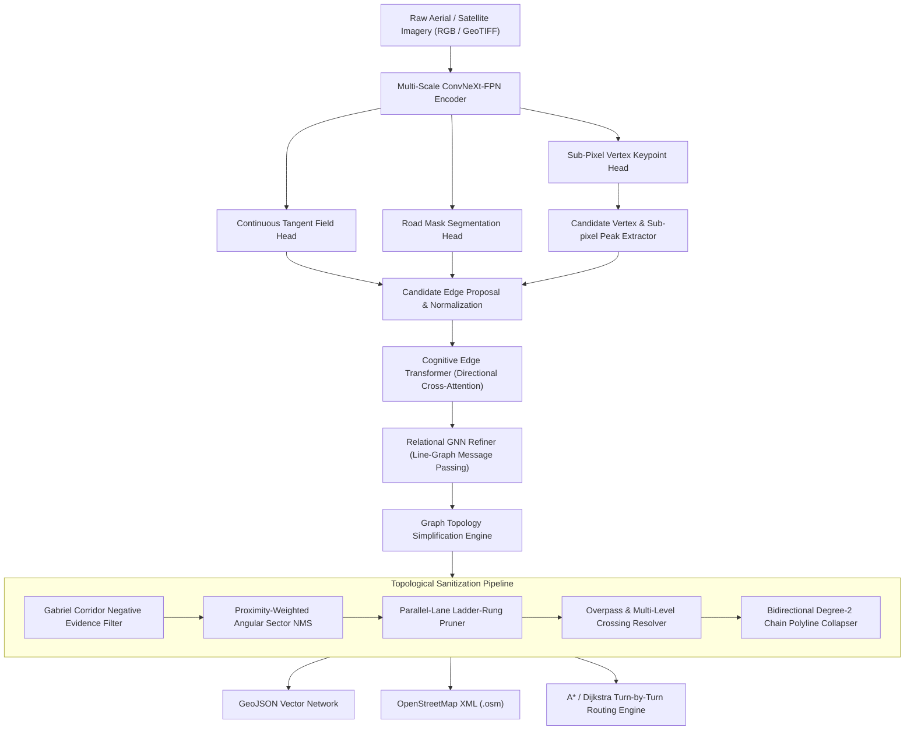

# TopoGrapher: Technical Architecture & Mathematical Foundations

TopoGrapher is an autonomous deep-learning and topological graph reasoning engine designed to extract routable vector road networks directly from aerial and satellite imagery.

---

## 1. Multi-Scale Feature Encoder (ConvNeXt-FPN)

The visual encoder processes raw aerial images of arbitrary size $(H, W, 3)$ using a 4-stage inverted bottleneck design with $7 \times 7$ depthwise convolutions, GeLU non-linearities, and LayerNorm. A Feature Pyramid Network (FPN) extracts multi-resolution feature maps across 4 scales:

$$\mathbf{P}_2, \mathbf{P}_3, \mathbf{P}_4, \mathbf{P}_5 \quad \text{with channels } C = 64$$

The pyramid outputs are merged via bilinear interpolation and depthwise convolution into a single high-resolution representation $\mathbf{F} \in \mathbb{R}^{C \times \frac{H}{2} \times \frac{W}{2}}$.

---

## 2. Dense Keypoint, Heading & Mask Prediction Heads

From the fused multi-scale feature map $\mathbf{F}$, three parallel heads produce dense geometric guidance:

1. **Sub-Pixel Keypoint Heatmap Head**:
   $$\mathbf{K} \in [0, 1]^{3 \times \frac{H}{2} \times \frac{W}{2}}$$
   Predicts probability of road structural elements:
   - Channel 0: Intersection junctions ($\text{degree} \ge 3$)
   - Channel 1: Dead-end terminals ($\text{degree} = 1$)
   - Channel 2: Intermediate corridor waypoints ($\text{degree} = 2$)

2. **Continuous Heading Tangent Head**:
   $$\mathbf{T} = (\cos 2\phi, \sin 2\phi) \in \mathbb{R}^{2 \times \frac{H}{2} \times \frac{W}{2}}$$
   Parameterizes undirected road orientation via double-angle trigonometric vectors, eliminating discontinuity at $\pm \pi$.

3. **Corridor Road Segmentation Head**:
   $$\mathbf{M} \in [0, 1]^{1 \times \frac{H}{2} \times \frac{W}{2}}$$
   Predicts dense road surface existence.

Candidate vertices $\mathcal{V} = \{v_i = (x_i, y_i)\}$ are extracted via local non-maximum suppression (NMS) on heatmap peaks with quadratic sub-pixel interpolation.

---

## 3. Cognitive Multi-Modal Edge Transformer

For any candidate pair of vertices $(u, v)$ with distance $d(u, v) \le d_{\max}$, the corridor is parameterized into normalized coordinates. 

The edge transformer samples $K=14$ points uniformly along the segment:
$$\mathbf{p}(t) = (1 - t) \mathbf{p}_u + t \mathbf{p}_v, \quad t \in [0.1, 0.9]$$

Features from $\mathbf{F}$, along with orientation alignment $\mathbf{T} \cdot (\cos 2\theta, \sin 2\theta)$ and road surface probability $\mathbf{M}$, are pooled via bilinear grid sampling into contextual tokens $\mathbf{E}_{uv} \in \mathbb{R}^{D}$.

Multi-head self-attention models global spatial context across candidate pairs:
$$\mathbf{A} = \text{Softmax}\left(\frac{\mathbf{Q} \mathbf{K}^T}{\sqrt{d_k}}\right) \mathbf{V}$$

Outputting existence probability $P(e_{uv} \in \mathcal{E})$ and functional road classification (Highway, Arterial, Residential).

---

## 4. Relational GNN Refiner (Line-Graph Attention)

To enforce topological flow conservation (e.g. roads entering an intersection must continue rather than dead-end spuriously), candidate edges are refined via message passing on their **Line Graph** $\mathcal{L}(\mathcal{G})$:

$$\mathbf{M}_{ij} = \begin{cases} 0 & \text{if } e_i \cap e_j \neq \emptyset \text{ (incident edges sharing a node)} \\ -\infty & \text{otherwise} \end{cases}$$

Edge embeddings exchange contextual relational tokens across 2 GAT layers:
$$\mathbf{h}_i^{(l+1)} = \text{LayerNorm}\left(\mathbf{h}_i^{(l)} + \sum_{j \in \mathcal{N}(i)} \alpha_{ij} \mathbf{W}_v \mathbf{h}_j^{(l)}\right)$$

---

## 5. Graph Topology Simplification Engine

Raw neural predictions inevitably contain geometric edge cases: multi-degree spiderwebs, redundant diagonal chords across corners, and ladder rungs between parallel lanes. TopoGrapher applies an automated 6-stage mathematical simplifier:

### 5.1. Gabriel Corridor Non-Skipping Filter
An edge $(u, v)$ is pruned if an intermediate road node $w$ lies strictly within the corridor span:
$$\text{dist}_{\perp}(w, uv) \le 12.0\,\text{px} \quad \text{and} \quad t = \frac{\vec{uw} \cdot \vec{uv}}{\|\vec{uv}\|^2} \in [0.15, 0.85]$$
This eliminates chords that leap across multi-hop intersections.

### 5.2. Proximity-Weighted Angular Sector NMS
Within any angular cone of width $\theta_{\text{cone}} = 28^\circ$, at most ONE candidate edge can exit a node. Candidate edges are prioritized by:
$$\text{Score}(u, v) = \frac{P(e_{uv})}{1.0 + 0.005 \cdot d(u, v)}$$
Favoring immediate adjacent connectivity over long-distance leaps.

### 5.3. Parallel-Road Ladder-Rung Pruner
Transverse rungs $(u, v)$ between parallel road corridors are identified and removed when:
$$\left|\cos(\vec{\text{dir}}_u, \vec{\text{dir}}_v)\right| > 0.85 \quad \text{and} \quad \left|\cos(\vec{uv}, \vec{\text{dir}}_u)\right| < 0.40$$

### 5.4. Grade-Separation Overpass Resolver
Crossings between long highway edges ($L > 80\,\text{px}$) with crossing angle $\ge 70^\circ$ are preserved as grade-separated bridges (`layer=1`, `bridge=yes`) rather than split into planar 4-way junctions.

### 5.5. Degree-2 Polyline Chain Collapsing
Non-junction degree-2 chains $(u_0 - u_1 - \dots - u_k)$ are collapsed into single unified edges $(u_0, u_k)$ with attached polyline coordinate geometries, ensuring clean graph topologies for GIS and routing.
